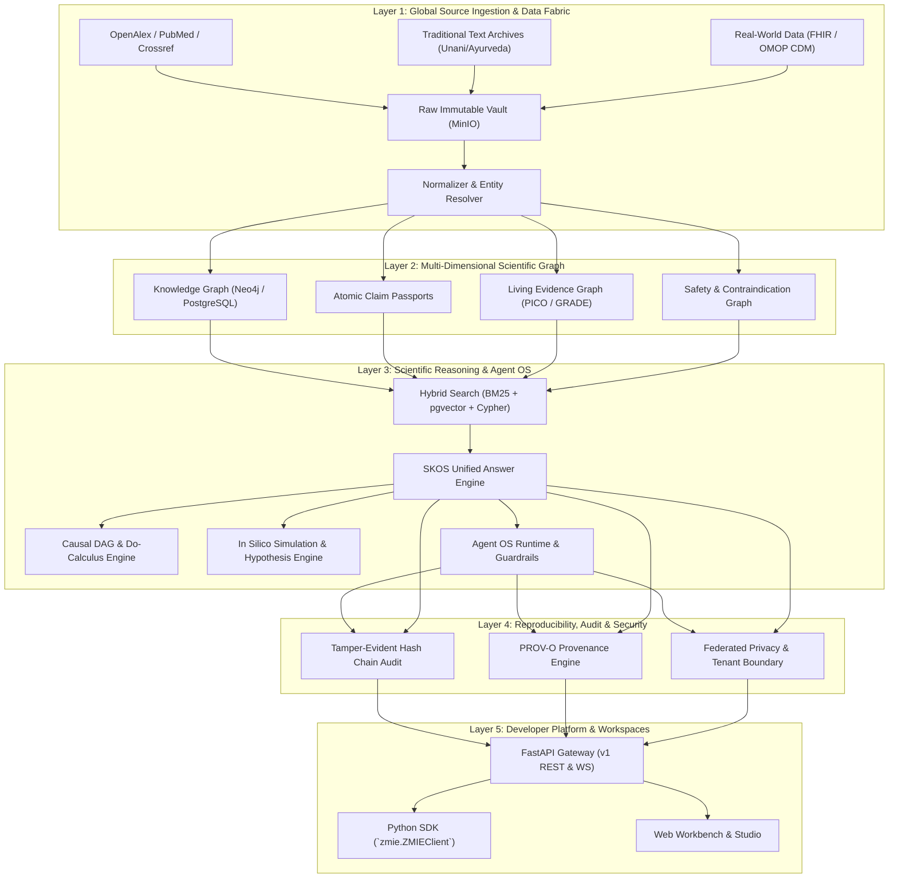

# ZMIE Architecture Specification & Codebase Map

**System:** ZMIE — ZAYVORA Medical Intelligence Engine  
**Classification:** Enterprise Scientific Knowledge Operating System  
**Architecture Spec Reference:** [`docs/architecture/enterprise_production_build_specification.md`](docs/architecture/enterprise_production_build_specification.md) & [`docs/architecture/canonical_architecture_v1.md`](docs/architecture/canonical_architecture_v1.md)  

---

## 1. High-Level System Architecture

ZMIE is structured as an API-first, event-driven, multi-tenant scientific operating system. It ingests global biomedical evidence, structures it into immutable knowledge and claim graphs, and exposes reproducible research compute, simulation, and synthesis tools to researchers, clinicians, and autonomous agents.



---

## 2. Directory Layout & Module Mapping

```text
zmie/
├── Makefile                                # Developer & CI automation entrypoint
├── LICENSE                                 # Apache 2.0 with Healthcare Governance Rider
├── README.md                               # Project Overview & Quickstart
├── CONTRIBUTING.md                         # Contribution Guidelines & PR Template
├── ARCHITECTURE.md                         # This file: Architecture & Module Map
├── SECURITY.md                             # Threat Model, HIPAA/GDPR & Disclosure
├── CHANGELOG.md                            # Versioned changes and release history
├── .env.example                            # Enterprise environment variables
├── docker-compose.yml                      # Local infrastructure stack
│
├── docs/                                   # Architectural Decision Records & Specs
│   ├── ZMIE_ENTERPRISE_PRODUCTION_BUILD_SPECIFICATION.md
│   ├── ZMIE_CURRENT_STATE_REPORT.md
│   └── ... (Subsystem Architecture Specs)
│
├── sdk/
│   └── python/                             # Official Python SDK (`zmie`)
│       ├── zmie/client.py                  # Typed ZMIEClient with full sub-namespaces
│       └── pyproject.toml
│
├── services/
│   ├── engine/                             # Core Scientific Knowledge Engine
│   │   ├── app/
│   │   │   ├── main.py                     # FastAPI application & router mounts
│   │   │   ├── core/                       # Identity, Tenancy, RBAC/ABAC, Config, Audit
│   │   │   ├── models/                     # Canonical domain models (Pydantic / SQL)
│   │   │   ├── db/                         # PostgreSQL DDL, migrations, Neo4j client
│   │   │   ├── api/v1/                     # REST API route handlers
│   │   │   ├── sources/                    # Source Registry & Authority Tiers
│   │   │   ├── ingestion/                  # Connectors & 12-stage Ingestion Pipeline
│   │   │   ├── ontology/                   # Cross-system Traditional & Modern Ontologies
│   │   │   ├── ontology_engine/            # Concept Drift & Semantic Evolution Engine
│   │   │   ├── graph/                      # Knowledge, Evidence & Safety Graphs
│   │   │   ├── search/                     # Hybrid BM25 + Vector + Graph search
│   │   │   ├── rwe/                        # FHIR & OMOP CDM v5.4 Harmonizer
│   │   │   ├── causal_mechanistic/         # Causal DAGs & Target Modulation
│   │   │   ├── living_evidence/            # PICO Extraction & Continuous Synthesis
│   │   │   ├── clinical_regulatory/        # Trial Matching & Regulatory Guidance
│   │   │   ├── simulation_hypothesis/      # In Silico Trials & Hypothesis DAGs
│   │   │   ├── scientific_compute/         # Sandbox Execution & Protocol Engine
│   │   │   ├── collaboration_network/      # Global Co-authorship & COI Engine
│   │   │   ├── federated_privacy/          # Differential Privacy & Secure Aggregation
│   │   │   ├── agent_os/                   # Scientific Agent OS & Execution Limits
│   │   │   ├── skos/                       # Scientific Knowledge Operating System
│   │   │   ├── audit/                      # Hash-Chained Audit & Reproducibility Ledger
│   │   │   └── enterprise_spec/            # Specification Engine & ADR Validators
│   │   └── pyproject.toml
│   └── web/                                # Next.js 15 Web Workbench
└── tests/                                  # 288+ Automated Test Suite
```

---

## 3. Core Architectural Invariants (INV-01–INV-10)

1. **INV-01 (Zero Fabrication):** If scientific evidence does not exist or is unknown, return `UNKNOWN` / `NO_EVIDENCE`. Never fabricate plausible-sounding citations or mechanisms.
2. **INV-02 (Tenant Boundary Isolation):** Tenant A must never access Tenant B datasets, research snapshots, cache entries, or private embeddings.
3. **INV-03 (Immutable Raw Evidence):** Raw ingested documents are stored with SHA-256 hashes in immutable object storage and cannot be overwritten.
4. **INV-04 (Epistemic Distance Preservation):** Traditional medicine concepts (Unani Mizaj, Ayurveda Doshas) are linked via epistemological bridge nodes with explicit distance scores, never 1:1 biomedical identity.
5. **INV-05 (Audit Hash-Chain Integrity):** Every research query, claim synthesis, and data computation produces an immutable cryptographic ledger entry linked to the previous block hash.
6. **INV-06 (Claim Passport Atomicity):** A claim cannot exist without an immutable source citation, confidence interval, and GRADE score.
7. **INV-07 (Retraction Cascades):** When a paper is marked retracted, all dependent claims and synthesized conclusions are downgraded or invalidated within 1 hour.
8. **INV-08 (Reproducible Computation):** Computational research jobs must pin container hash, package lockfile, input data hash, and random seed.
9. **INV-09 (Differential Privacy Floor):** Federated queries enforce strict \(\varepsilon \le 1.0, \delta \le 10^{-5}\) differential privacy guarantees.
10. **INV-10 (Fail-Safe Truth Firewall):** Clinical safety and contraindication checks run independently of LLM reasoning with deterministic rule sets.
