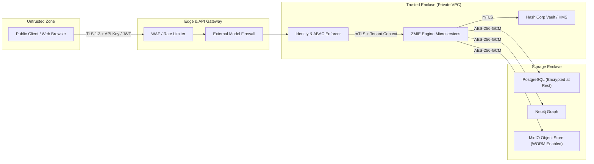

# ZMIE Security Policy & Threat Model

**Platform:** ZAYVORA Medical Intelligence Engine (ZMIE)  
**Classification:** Enterprise Healthcare & Scientific Intelligence Infrastructure  
**Standard:** Enterprise Security Hardening & Zero-Trust Architecture Standards  

---

## 1. Vulnerability Disclosure Policy

We take the security of medical knowledge, patient privacy, and computational integrity with utmost gravity.

If you believe you have found a security vulnerability in ZMIE:
1. **Do not disclose publicly.** Report immediately via encrypted email to:  
   `security@zmie.org` (PGP Key ID: `0xZMIE_SEC_2026`)
2. **Response SLA:** Our security team acknowledges reports within **24 hours**.
3. **Remediation SLA:** Critical severity issues are patched and verified within **72 hours**.
4. **Safe Harbor:** Security researchers acting in good faith who do not disrupt production operations or access unauthorized patient/tenant data will be granted full legal safe harbor.

---

## 2. Threat Model & Trust Boundaries

### Mandatory Trust Boundaries:
1. **Tenant Boundary (Mandatory Invariant INV-02):**
   - Every database query and cache lookup MUST carry an explicit `tenant_id`.
   - Direct cross-tenant data sharing is prohibited unless explicitly federated via Differential Privacy (\(\varepsilon \le 1.0\)).
2. **External Model Firewall:**
   - Raw user prompts and sensitive clinical identifiers are scrubbed before reaching any public LLM provider.
   - Fallback circuit breakers activate automatically if external model providers fail or drift.
3. **Raw Evidence Vault Immutability:**
   - Ingested literature and RWD artifacts are written to WORM (Write Once, Read Many) MinIO buckets with SHA-256 integrity checksums.

---

## 3. Regulatory Compliance Architecture

### HIPAA Compliance
- **Safe Harbor De-identification:** All Real-World Data (RWD) and patient records processed through the FHIR / OMOP harmonizers must have the 18 HIPAA identifiers stripped or pseudonymized prior to indexing.
- **ePHI Encryption:** AES-256-GCM encryption at rest; TLS 1.3 with forward secrecy in transit.

### FDA 21 CFR Part 11 Compliance
- **Audit Trails:** Immutable, computer-generated, time-stamped audit trails recording the date and time of operator entries and actions that create, modify, or delete electronic records.
- **Digital Signatures:** Cryptographically verifiable researcher signatures using SHA-256 HMAC or RSA signatures on research snapshots and protocol executions.

### GDPR Article 9 (Special Category Health Data)
- **Cryptographic Salt Shredding:** In accordance with the Right to Erasure, patient records can be irreversibly scrubbed by destroying individual encryption salt keys without disrupting the global hash-chained audit ledger.
