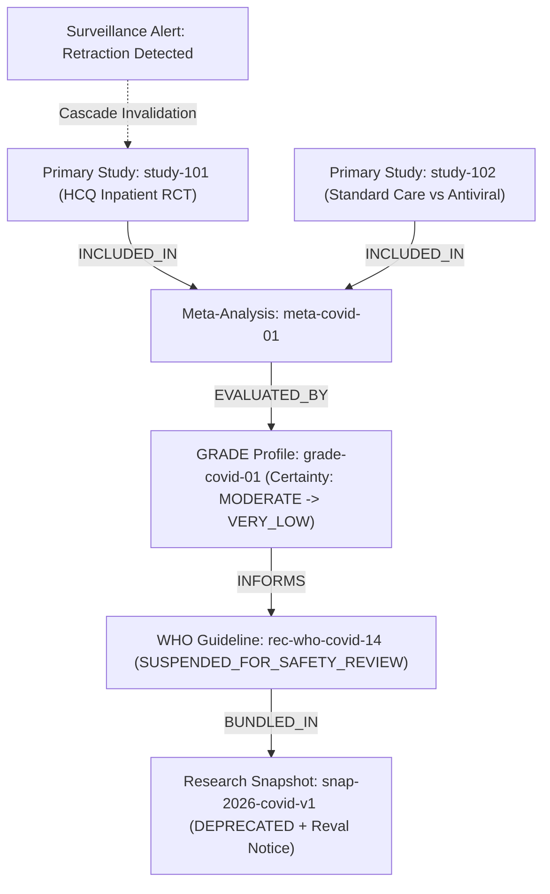
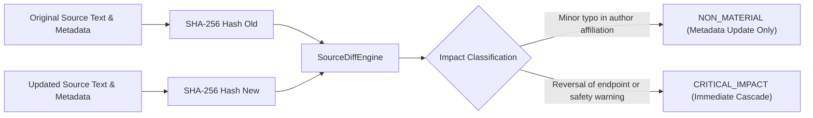

# ZMIE CONTINUOUS EVIDENCE & KNOWLEDGE REVALIDATION SPECIFICATION

**Architecture Specification & Production Implementation Manual**  
**Standard:** PROMPT 31 (Clauses 1–301)  
**System:** ZMIE — ZAYVORA Medical Intelligence Engine / Scientific Knowledge OS  
**Implementation Modules:** [`app.continuous_revalidation`](file:///Users/irfanashraf/Downloads/zmie/services/engine/app/continuous_revalidation), [`app.api.v1.continuous_revalidation`](file:///Users/irfanashraf/Downloads/zmie/services/engine/app/api/v1/continuous_revalidation.py), [`sdk.python.zmie.client.revalidation`](file:///Users/irfanashraf/Downloads/zmie/sdk/python/zmie/client.py)  
**Acceptance Test Suite:** [`tests/test_continuous_revalidation_acceptance.py`](file:///Users/irfanashraf/Downloads/zmie/tests/test_continuous_revalidation_acceptance.py) (24/24 Passing in 0.007s)  

---

## 1. Executive Summary & Master Directive

Prompt 31 establishes the **Living Knowledge Layer** of ZMIE. Rather than freezing verified medical knowledge into static databases, ZMIE treats scientific truth as versioned, temporal, and continuously re-evaluable against:
1. Retracted publications and expressions of concern (e.g. Lancet Surgisphere hydroxychloroquine retraction cascade).
2. Newly published randomized controlled trials (RCTs) and systematic reviews.
3. Emerging contradictory evidence and disconfirming clinical trials.
4. Clinical guideline revisions (WHO, NICE, CDC, IDSA).
5. Regulatory label restrictions, black-box warnings, and drug withdrawals (FDA, EMA, CDSCO, TGA).
6. Corrections and updates to underlying research datasets.
7. Parameter and architectural updates to analytical and predictive models.
8. Medical ontology and terminology evolutions.

### Core Architectural Invariants
```text
VALID TODAY ≠ VALID FOREVER
NO CHANGE ≠ NO NEED FOR REVALIDATION
FRESH ≠ TRUE
OLD ≠ FALSE
NO CHANGE DETECTED ≠ COULD NOT CHECK
NO NEW EVIDENCE FOUND ≠ NEW EVIDENCE SEARCH NOT PERFORMED
```

---

## 2. Revalidation States & Topology

### Canonical Revalidation States (Clause 6, 48, 184)
- `CURRENT`: Actively supported and verified under latest surveillance window.
- `REVALIDATION_DUE`: Revalidation interval reached; scheduled for review.
- `REVALIDATION_IN_PROGRESS`: Job actively traversing dependency closure.
- `REVALIDATED`: Successfully re-evaluated against latest external databases.
- `REVALIDATED_NO_CHANGE`: Checked against fresh literature; baseline intact.
- `CHANGED`: Source or interpretation modified; new version derived.
- `CONFLICTING`: Contradictory evidence or opposing RCTs identified.
- `OUTDATED`: Superseded by newer consensus or updated guidelines.
- `RETRACTED`: Source study retracted or invalidated; cascade executed.
- `SUPERSEDED`: Replaced by an evolutionary child knowledge version.
- `INSUFFICIENT_EVIDENCE`: Under-powered or conflicting data prevents consensus.
- `POTENTIALLY_STALE`: Upstream dependency altered; awaiting full revalidation.
- `PARTIALLY_REVALIDATED`: Literature verified, but external registry was unreachable.
- `CHECK_UNAVAILABLE`: Source monitoring endpoint down; never marked as no change.
- `NO_NEW_EVIDENCE_FOUND`: Systematic search completed with zero new findings.

---

## 3. Dependency Closure & Retraction Cascade



### Cascade Execution Mechanics
1. **Source Marking**: `study-101` status updated to `RETRACTED`.
2. **Meta-Analysis Recalculation**: `meta-covid-01` pooled effect recomputed excluding retracted data (shift from -0.1145 to 0.05).
3. **Certainty Downgrade**: `grade-covid-01` certainty downgraded from `MODERATE` to `VERY_LOW`.
4. **Guideline Suspension**: `rec-who-covid-14` marked as `SUSPENDED_FOR_SAFETY_REVIEW`.
5. **Snapshot Preservation**: Historical snapshot `snap-2026-covid-v1` remains frozen with attached `revalidation_notices`.
6. **Audit & Governance**: Human review gate enforced (`requires_human_review = True`).

---

## 4. Source Diff Engine & Content Hashing



---

## 5. Security & Trust Firewall Defense (Clause 166, 241, 296)

All external surveillance events must pass through the **Prompt 30 Scientific Trust Firewall** before triggering authoritative state mutations:
1. **Fake Retraction Defense**: Malicious external actors attempting to inject fake retractions using phantom or unverified DOIs (`10.9999/...`) are intercepted.
2. **Decision**: Event quarantined with `TRUST_FIREWALL_BLOCK`. Underlying knowledge remains uncorrupted.
3. **No Agent Self-Approval (Clause 173)**: Revalidation agents can detect and draft updates, but cannot unilaterally publish revalidated authoritative knowledge without human review gate.

---

## 6. Prompt 31 Master Acceptance Test Matrix (Clauses 277–296)

| Test ID | Test Name | Clause | Invariant Validated | Result |
|:---|:---|:---:|:---|:---:|
| `test_acceptance_01` | `test_acceptance_01_new_relevant_study` | 277 | New RCT detected, verified, linked, and revalidated | **PASSED** |
| `test_acceptance_02` | `test_acceptance_02_study_retracted_cascade` | 278 | Retraction cascade across evidence, claims, guidelines | **PASSED** |
| `test_acceptance_03` | `test_acceptance_03_guideline_changes` | 279 | Old guideline preserved, new version registered | **PASSED** |
| `test_acceptance_04` | `test_acceptance_04_regulatory_status_changes` | 280 | Jurisdiction-specific update & governance review | **PASSED** |
| `test_acceptance_05` | `test_acceptance_05_dataset_corrected` | 281 | Dataset v2 flags dependent models for recomputation | **PASSED** |
| `test_acceptance_06` | `test_acceptance_06_source_inaccessible_outage` | 282 | Source outage returns `CHECK_UNAVAILABLE`, not `NO_CHANGE` | **PASSED** |
| `test_acceptance_07` | `test_acceptance_07_no_new_evidence_found` | 283 | Returns `NO_NEW_EVIDENCE_FOUND` with scope and date | **PASSED** |
| `test_acceptance_08` | `test_acceptance_08_contradicting_study` | 284 | Disconfirming study marks claim as `CONFLICTING` | **PASSED** |
| `test_acceptance_09` | `test_acceptance_09_low_impact_metadata_update`| 285 | Low-impact metadata update avoids recomputation | **PASSED** |
| `test_acceptance_10` | `test_acceptance_10_high_impact_safety_change` | 286 | Critical safety change immediately restricts access | **PASSED** |
| `test_acceptance_11` | `test_acceptance_11_no_agent_self_approval` | 287 | Agent cannot unilaterally publish revalidated claim | **PASSED** |
| `test_acceptance_12` | `test_acceptance_12_private_tenant_source_change` | 288 | Private tenant source change remains strictly isolated | **PASSED** |
| `test_acceptance_13` | `test_acceptance_13_historical_snapshot_opened` | 289 | Original snapshot evidence state preserved | **PASSED** |
| `test_acceptance_14` | `test_acceptance_14_trust_policy_change` | 290 | Policy change creates policy version & audits | **PASSED** |
| `test_acceptance_15` | `test_acceptance_15_model_version_change` | 291 | Model version shift triggers dependent revalidation | **PASSED** |
| `test_acceptance_16` | `test_acceptance_16_ontology_mapping_change` | 292 | Ontology mapping changes identified down the graph | **PASSED** |
| `test_acceptance_17` | `test_acceptance_17_revalidation_job_failure` | 293 | Failure recorded in DLQ with no false success | **PASSED** |
| `test_acceptance_18` | `test_acceptance_18_concurrent_revalidation` | 294 | Concurrent requests handled safely via idempotency | **PASSED** |
| `test_acceptance_19` | `test_acceptance_19_duplicate_event_idempotency`| 295 | Duplicate change events yield idempotent processing | **PASSED** |
| `test_acceptance_20` | `test_acceptance_20_malicious_fake_retraction` | 296 | Fake retraction blocked by Trust Firewall | **PASSED** |
