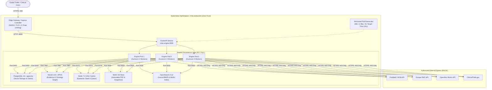

# ZMIE Cloud & Production Deployment Guide
### Enterprise Zero-Trust Container Topology, Kubernetes Manifests & Edge SSL Architecture

---

## 1. Production Architecture Overview

The **ZAYVORA Medical Intelligence Engine (ZMIE)** is designed for multi-tenant, zero-trust cloud deployment across private institutional clouds, AWS EKS, GCP GKE, Azure AKS, or bare-metal Linux servers.



---

## 2. Deployment Strategies

### Option A: Hardened Docker Compose (`deploy/docker-compose.prod.yml`)
Best suited for single-server enterprise pilots, staging environments, and dedicated on-premise hospital VM deployments.

```bash
# 1. Automated one-command deployment
./zmie deploy

# Or manually via Makefile
make deploy
```

**Key Features**:
- **NGINX Edge Proxy**: Handles TLS 1.2/1.3 termination, rate limiting (`30r/s`), Gzip payload compression, and HSTS security headers.
- **Worker Clustering**: Runs FastAPI via `gunicorn` with 4 `uvicorn.workers.UvicornWorker` processes.
- **Isolated Network Topology**: Databases and storage are isolated on `zmie-internal-net` (no external ports exposed to the public internet).

---

### Option B: Zero-Trust Kubernetes (`deploy/k8s/`)
Best suited for institutional high-availability clusters (AWS EKS, GCP GKE, Azure AKS, Red Hat OpenShift).

```bash
# 1. Automated Kubernetes deployment
./zmie deploy k8s

# Or manually via Makefile
make deploy-k8s
```

**Manifests Catalog**:
| Manifest | Purpose |
| :--- | :--- |
| [`deploy/k8s/namespace.yaml`](file:///Users/irfanashraf/Downloads/zmie/deploy/k8s/namespace.yaml) | Defines `zmie-production` with HIPAA compliance metadata. |
| [`deploy/k8s/configmap.yaml`](file:///Users/irfanashraf/Downloads/zmie/deploy/k8s/configmap.yaml) | Environment configurations and internal cluster URIs. |
| [`deploy/k8s/secret.yaml`](file:///Users/irfanashraf/Downloads/zmie/deploy/k8s/secret.yaml) | Cryptographic HMAC keys, DB passwords, and S3 credentials. |
| [`deploy/k8s/engine-deployment.yaml`](file:///Users/irfanashraf/Downloads/zmie/deploy/k8s/engine-deployment.yaml) | 3-replica rolling deployment with non-root security context. |
| [`deploy/k8s/engine-service.yaml`](file:///Users/irfanashraf/Downloads/zmie/deploy/k8s/engine-service.yaml) | Internal ClusterIP service on port 8000. |
| [`deploy/k8s/hpa.yaml`](file:///Users/irfanashraf/Downloads/zmie/deploy/k8s/hpa.yaml) | Horizontal Pod Autoscaler (3 to 10 pods). |
| [`deploy/k8s/ingress.yaml`](file:///Users/irfanashraf/Downloads/zmie/deploy/k8s/ingress.yaml) | Ingress controller routing for `api.zmie.ai` and `workbench.zmie.ai`. |
| [`deploy/k8s/network-policy.yaml`](file:///Users/irfanashraf/Downloads/zmie/deploy/k8s/network-policy.yaml) | Zero-trust default-deny network rules with authorized clinical egress. |
| [`deploy/k8s/infrastructure/`](file:///Users/irfanashraf/Downloads/zmie/deploy/k8s/infrastructure/) | StatefulSets for Postgres (pgvector), Neo4j, Redis, and MinIO. |

---

## 3. High Availability, Health Probes & Scaling

1. **Liveness Probe**: Monitored on `GET /health` (failure triggers pod restart after 3 attempts).
2. **Readiness Probe**: Monitored on `GET /health` (failure removes pod from upstream traffic routing).
3. **Autoscaling Thresholds**:
   - Scales up immediately when average CPU exceeds 75% or memory exceeds 80%.
   - 300-second stabilization cooldown window prevents flapping during variable clinical workloads.
4. **Zero-Downtime Rolling Updates**:
   - `maxSurge: 1`
   - `maxUnavailable: 0` (guarantees that 3 healthy pods are always running during new image rollouts).

---

## 4. Cryptographic Audit & Invariant Verification

Before every deployment rollout, the deployment orchestrator (`deploy/scripts/deploy_production.sh`) automatically executes:
1. `python3 scripts/audit_harness.py`: Validates all 8 quality gates.
2. `tests/test_*.py`: Confirms 515 unit and security tests pass.
3. Cryptographic Merkle audit chain verification (`INV-10`).
